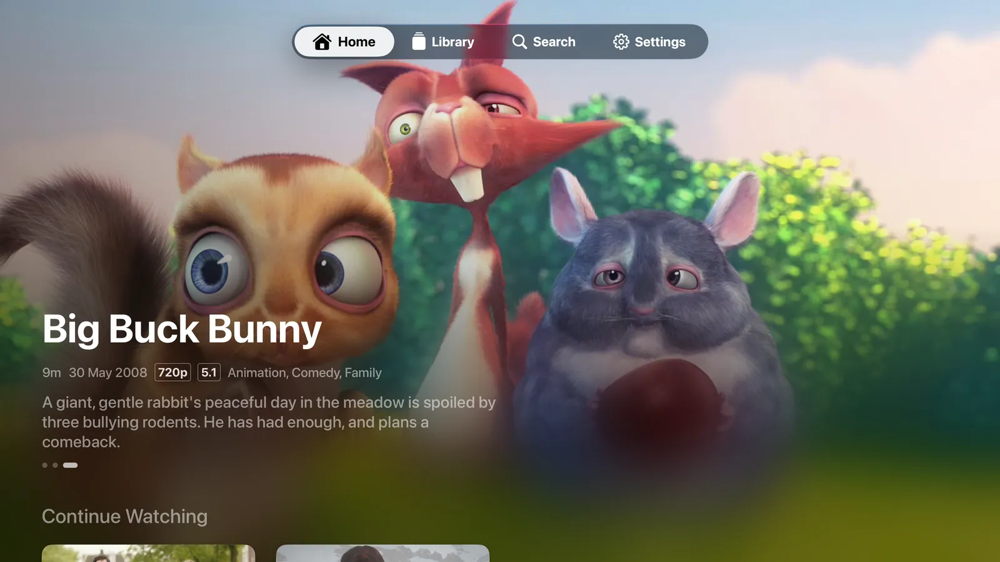
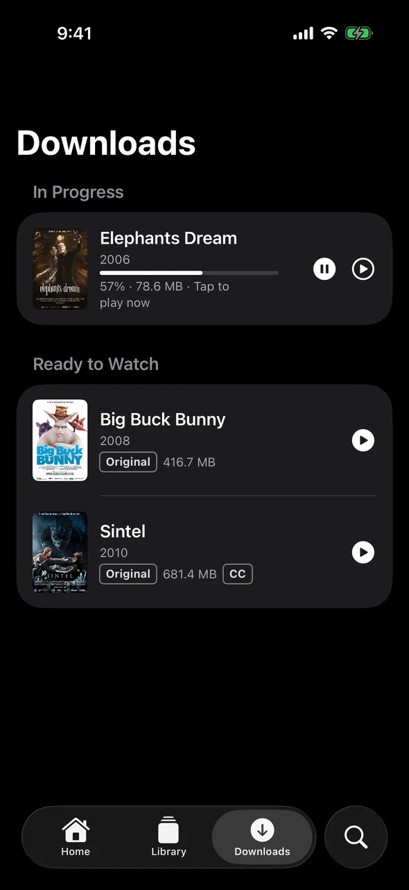
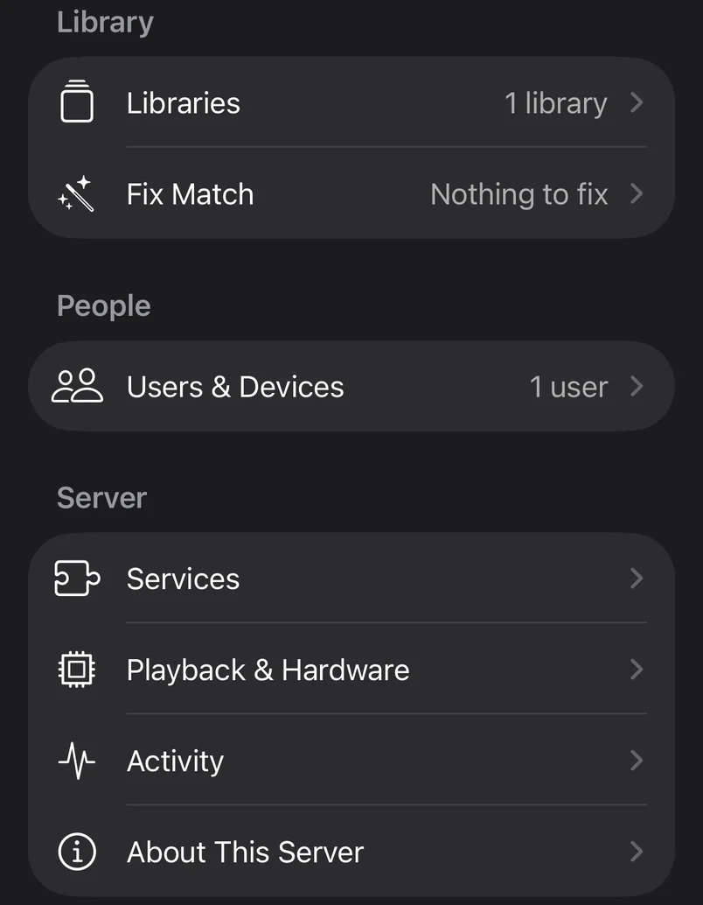

# Moonrise

**A self-hosted video library: a small server next to your movies and shows, and native apps for
iPhone, iPad, Mac, Apple TV, Android TV, Android phones and tablets, and Windows.** Put the
server on a NAS, a home server, a Mac or a Raspberry Pi, open the app, and it guides you through
the rest. Your library, your devices, your network: no account with anyone, no cloud in between.

<p align="center">
  
</p>
<p align="center">
  
  &nbsp;
  
</p>

<sub>The library in the screenshots is the Blender Foundation's open movies ([credits](site/CREDITS.md)).</sub>

The project's page: **<https://getmoonrise.dev/>** (its source is [`site/`](site/README.md)).

## Status

Moonrise is **pre-release**. It is in daily use, but nothing is in an app store yet and the
server image isn't published: for now you build the server and the apps from this repository
(below). The server is at version 0.33.0 ([CHANGELOG.md](CHANGELOG.md)); the apps are at 0.1.0.

| Platform | Folder | Built with | State |
|---|---|---|---|
| Server (Linux, NAS, macOS, Raspberry Pi) | [`server/`](server/README.md) | Rust, ffmpeg, SQLite | Everything the apps use; runs in Docker or as a macOS service |
| iPhone, iPad, Mac, Apple TV | [`clients/apple/`](docs/building.md#apps-clientsapple-ios-ipados-macos-tvos-26) | SwiftUI (iOS, iPadOS, macOS, tvOS 26) | The most complete app: everything below, including setup and Manage Server |
| Android TV (Google TV) | [`clients/android/`](clients/android/README.md) | Kotlin, Compose for TV, Media3 | Sign-in, Home, Library, Search, title pages, the player, the home screen's Watch Next row |
| Android phones and tablets | [`clients/android/`](clients/android/README.md#the-phone-app) | Kotlin, Compose, Media3 | Follows the iPhone and iPad app: setup, downloads, Manage Server, Fix Match |
| Windows 10 (2004 or later) and 11, x64 | [`clients/windows/`](clients/windows/README.md) | C#, WinUI 3, libmpv | Sign-in and setup, Home, Library, Search, title pages, the player, Settings. Not yet: downloads, Manage Server, remote access; the installer is unsigned |

## What it does

- **Plays everything** you have: MKV, MP4, AVI and more; H.264, HEVC/HDR, AV1, DivX… The server
  repackages what a device can play as it is (instant start, instant seeking, every audio track)
  and transcodes only what it can't: on an NVIDIA, Intel or AMD GPU, else on the CPU.
- **Recognises your library** by itself: movies and shows side by side in any folder layout,
  posters, plots, cast and episode names from TMDB, local artwork and NFO files when you prefer.
  Fix Match for the odd one out.
- **Subtitles**: embedded and sidecar tracks show from the first second, even over a slow NAS;
  search and fetch from OpenSubtitles in the player.
- **Downloads** for the plane, at any quality, playable while they download (iPhone, iPad, Mac,
  Android phones).
- **Continue Watching** (in progress, the next episode, the next film of a collection) and
  watched state per user, the same on every device; invite family members.
- **Folders on the server or on network shares** (SMB: a NAS, a Windows PC): the server reads
  them itself, no mounting.
- **Away from home** with Tailscale, built into the Apple apps (no VPN app needed).
- **Set up and managed from the app**: libraries, users and devices, services, transcoding
  hardware, activity, logs. There is no web admin to learn.
- **Try it without a server**: the Apple apps' welcome screen has *Try the Demo*, four open movies
  from the Blender Foundation.

## Quick start

You need Docker with the compose plugin on the machine that will run the server, and git.

1. **Build and run the server** from a clone of this repository:

   ```sh
   git clone https://github.com/paralainer/moonrise.git moonrise
   cd moonrise/server
   docker compose up -d --build      # the first build takes a few minutes
   ```

   [`server/docker-compose.yml`](server/docker-compose.yml) builds the image from `server/` and
   keeps the server's data in `server/moonrise-data/`. If your videos are on this machine,
   uncomment the media folder line in it first (read-only); videos on a NAS need nothing there,
   you add the share in the app. On a Mac or a Raspberry Pi see [macOS](docs/install-macos.md)
   and [Raspberry Pi](docs/install-raspberry-pi.md); NAS templates for
   [Unraid](server/packaging/unraid/moonrise-server.xml),
   [Synology](server/packaging/synology/README.md) and
   [TrueNAS SCALE](server/packaging/truenas/README.md) will use the published image.

2. **Get the setup code**: `docker logs moonrise-server 2>&1 | grep "setup code"`, or open
   `http://<server>:8097/` in a browser on your network.

3. **Build and install an app** (next section), open it and choose **Connect to Your Server**. It
   finds the new server on your network (or type its address). Enter the 6-digit setup code,
   create your account, pick your video folder or network share, and watch the first scan come
   in.

Other devices then sign in with your account (on a TV: *Sign In with a Code*, approved on your
phone or at `http://<server>:8097/link`). More on running the server, settings, backups and the
command line: [server/README.md](server/README.md).

## Building the apps

| App | Needs | Build |
|---|---|---|
| iPhone, iPad, Mac, Apple TV | A Mac with Xcode 26 or later and [XcodeGen](https://github.com/yonaskolb/XcodeGen) | `scripts/xcodegen.sh`, then open `clients/apple/Moonrise.xcodeproj` and run the **Moonrise** scheme; or `make apple-sim` / `make apple-tv-sim` for a simulator. For your own devices, put your team and bundle id in `clients/apple/Config/Signing.local.xcconfig` first |
| Android TV | Docker | `clients/android/build.sh` → `clients/android/tv/build/outputs/apk/debug/tv-debug.apk`; install it with `scripts/deploy-android-tv.sh <tv-address>` or adb |
| Android phone and tablet | Docker | `clients/android/build.sh phone` → `clients/android/phone/build/outputs/apk/debug/phone-debug.apk`; `adb install` it |
| Windows | Windows 10 or 11, the .NET 10 SDK and Inno Setup | `powershell -ExecutionPolicy Bypass -File clients\windows\build.ps1` → an installer in `clients\windows\build\installer\` |

The Android debug builds are **Moonrise Dev**, a separate app beside a release build; a release
build needs your own signing key ([clients/android/README.md](clients/android/README.md#release-build-and-signing)).
The details for each platform, the toolchain versions and the build Mac scripts are in
[docs/building.md](docs/building.md).

## Optional services

Moonrise needs nothing but your videos. Each of these makes it better, and each has a fallback:

| Service | What it adds | Without it |
|---|---|---|
| TMDB (built into release builds; your own key optional) | Posters, plots, cast, episode names | Names from files and folders, NFO files, local artwork, a frame of the video |
| OpenSubtitles (built-in key; your account optional) | Subtitle search in the player: 5 downloads a day, 20 with a free account | Subtitles in and next to your files still play |
| An LLM (Anthropic, OpenAI, your ChatGPT plan, Gemini, OpenRouter, or your own model server: Ollama, LM Studio, llama.cpp, any OpenAI-compatible endpoint) | Recognises unusual or transliterated file names | Name, year and runtime matching; the rest wait in Fix Match |
| Tailscale | The Apple apps reach the server from anywhere | Home network only (downloads play anywhere) |
| GPU (NVIDIA, Intel, AMD; a Mac's VideoToolbox) | Fast transcoding, 4K | Transcoding on the CPU (up to 1080p; 720p on a Raspberry Pi) |
| OMDb (your free key, entered in the app and kept on the server) | IMDb / Rotten Tomatoes / Metacritic scores | TMDB's rating |

A server built from source has no built-in keys: it asks for your own TMDB key and OpenSubtitles
account in the app, or uses the fallbacks ([docs/building.md](docs/building.md#server-server)).
What is sent where: [docs/privacy.md](docs/privacy.md).

## Documentation

- [Running the server](server/README.md): install, settings, command line, backups
- [Server settings](docs/server-settings.md): everything the app sets, and the environment variables
- [Server on a Mac](docs/install-macos.md): Apple silicon and Intel, VideoToolbox, starts at login or boot
- [Server on a Raspberry Pi](docs/install-raspberry-pi.md): Docker, what a Pi 4 / Pi 5 can transcode
- [Hardware transcoding](docs/hardware-transcoding.md): NVIDIA, Intel Quick Sync, VA-API, VideoToolbox, V4L2, CPU, with measured speeds
- [Network shares (SMB)](docs/smb.md)
- [Remote access with Tailscale](docs/remote-access.md)
- [Privacy](docs/privacy.md)
- [Building from source](docs/building.md): the server and every app
- [The demo, and App Review notes](docs/demo.md)
- [Developer docs](docs/dev/README.md): architecture, server internals and API, testing, adding a client; [design decisions](docs/adr/README.md)

## Contributing

Issues and pull requests are welcome: see [CONTRIBUTING.md](CONTRIBUTING.md), and
[AGENTS.md](AGENTS.md) for the layout, commands and rules. From a clone: `make server-run` builds
and runs the server from source and prints its address and setup code, `make check` runs every
test and build a pull request must pass, and `make` lists the rest. Security problems:
[SECURITY.md](SECURITY.md).

## Support

Moonrise is free to use. If you want to support its development, it has a
[Buy Me a Coffee page](https://buymeacoffee.com/getmoonrise).

## License

Moonrise is free software, under two licences by directory:

| Path | Licence | Text |
|---|---|---|
| `server/` | [GNU Affero General Public License v3.0](server/LICENSE) or later (`AGPL-3.0-or-later`) | `server/LICENSE` |
| everything else: `clients/` (the Apple, Android and Windows apps), `api/`, `scripts/`, `docs/`, the Makefile | [Mozilla Public License 2.0](LICENSE) (`MPL-2.0`) | `LICENSE` |

Third-party code keeps its own licence; [THIRD-PARTY-NOTICES.md](THIRD-PARTY-NOTICES.md) lists
what each part uses and bundles. In short: `server/third_party/smb2` is MIT/Apache-2.0; the
server's Docker image includes jellyfin-ffmpeg (GPL) on amd64 or Debian's ffmpeg on arm64; the
Windows app bundles an LGPL build of libmpv ([ADR 0014](docs/adr/0014-windows-app.md)); the
Android apps use `media3-ffmpeg-decoder` (GPL-3.0), so a built Android app as a whole is
distributed under the GPL-3.0, which the MPL-2.0 allows, while its source stays MPL-2.0. The
demo's films are by the Blender Foundation under Creative Commons licences
([docs/demo.md](docs/demo.md)).

The name "Moonrise" and the Moonrise icon are not covered by these licences: see
[TRADEMARKS.md](TRADEMARKS.md).
