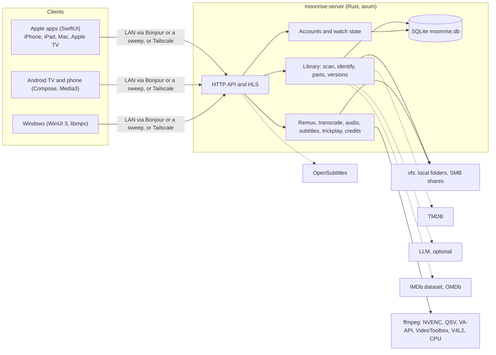

# Architecture

Moonrise is a Rust server that owns the library and the streams, and native clients that talk to
it over one HTTP API. This page is the map; [server.md](server.md) has the server's details and
every endpoint, and the [ADRs](../adr/README.md) say why the main choices were made.

## Repository layout

| Folder | What it holds |
|---|---|
| `server/` | The Rust server (`src/`), SQL migrations, Dockerfile, packaging (macOS, Unraid, Synology, TrueNAS, Raspberry Pi), `tools/` (format matrix, Samba test), vendored `third_party/smb2` |
| `clients/apple/` | One SwiftUI target for iOS, iPadOS, macOS and tvOS, plus widgets and a Top Shelf extension, generated by XcodeGen (`project.yml`) |
| `api/` | The API contract (`openapi.yaml`), example answers in `examples/`, and the shared rule cases (`*-rules.json`) every client's tests run |
| `clients/android/` | Self-contained Gradle project: `core/` (the API in plain Kotlin/JVM), `shared/` (Android code the apps share: session, settings, the player), `tv/` (the Android TV app), `phone/` (the phone and tablet app) |
| `clients/windows/` | The Windows app: `Moonrise.Core` (API and rules, plain C#), its tests, `Moonrise.App` (WinUI 3, libmpv), `build.ps1` and the installer |
| `scripts/` | Build, test and check scripts; `scripts/tests/` tests the scripts themselves |
| `docs/` | User docs; `docs/dev/` for contributors; `docs/adr/` for decisions |
| `assets/brand/` | Icon artwork (see its README); private working art stays out of the repo |

## Server (`server/src/`)

A library crate (`lib.rs`) with a thin binary: `main.rs` tunes the allocator, starts the Tokio
runtime and calls `cli::run`, the command line (`serve`, `user add`, `scan`, `llm-test`, …). The
modules, grouped in folders by layer:

| Folder | Layer | Modules |
|---|---|---|
| `src/` (top) | HTTP API | `api.rs` (playback, sessions, subtitles, `/v1/info`; `api_dv_tests.rs`), `downloads.rs`, `offline.rs`; `cli.rs` (command line), `mdns.rs` (Bonjour), `migrate.rs` (moving a library root) |
| `library/` | Library | `api.rs` (browse, items, Fix Match), `store.rs` (their queries), `scanner.rs` (polling), `parse.rs` (file names), `identify.rs`, `parts.rs` (split episodes), `versions.rs`, `metadata.rs`, `tmdb.rs`, `local.rs` (no-TMDB fallback), `images.rs`, `browse.rs`, `search.rs`, `ratings.rs`, `streams.rs` (track numbering) |
| `media/` | Media | `mod.rs` (loading a title), `item.rs`, `segment.rs` (cutting segments), `mkv.rs`, `moov.rs`, `mp4.rs`, `scan.rs` (keyframe indexes), `index_backfill.rs`, `transcode.rs`, `hwaccel.rs`, `audio.rs`, `trickplay.rs`, `credits.rs`, `segment_rules.rs` (the segments players offer) |
| `subtitles/` | Subtitles | `subs.rs`, `subx.rs` (Matroska extraction), `subsync.rs` (timing match; `subsync_eval.rs`), `opensubtitles.rs` |
| `auth/`, `userdata/` | Users | `auth/` (accounts, tokens, device codes; `api.rs`), `userdata/` (watch state, Continue Watching in `continuing.rs`; `api.rs`, its queries in `store.rs`) |
| `storage/`, `db/` | Storage | `vfs.rs` (one interface for local and SMB files), `smb.rs` (block cache, loopback HTTP for ffmpeg; `smb_it.rs`, the Samba tests), `source.rs`, `cache.rs`; `db/` (database, migrations) |
| `llm/` | LLM | `mod.rs` (the identification call), `admin.rs` (provider API), `keys.rs` (where a key may go), `chatgpt.rs` (Sign in with ChatGPT) |
| `admin/` | Administration and settings | `mod.rs` (settings and libraries API), `settings.rs` (precedence: environment, then the stored value, then a built-in key, then the default), `config.rs`, `services.rs`, `manage.rs` (users, devices, invitations, activity; its queries in `store.rs`), `claim.rs` (setup code), `logbuf.rs` (log buffer, redaction) |

HTTP handlers (the `api.rs` files) parse the request, call one function that runs the queries
inside `Db::call`, and shape the answer; the SQL lives beside the domain (`library/store.rs` for the
browse and Fix Match API), not in the handlers.

Modules refer to each other by full path (`crate::media::segment`, `crate::admin::config::Config`).
Log lines carry the module path as their target (`moonrise_server::media::transcode`), so
`RUST_LOG=moonrise_server::media=debug` turns on one layer.

## Data flow

**Scanning.** A quick pass every 120 s checks folder modification times and lists only changed
folders; a full walk runs every 6 h and at start. A file must be stable for 60 s before it's
probed (ffprobe, once per size and mtime). Renames are recognised by size, mtime and the
OpenSubtitles hash, so a renamed file keeps its id and watch state. A root that can't be read is
skipped for that pass and nothing under it is marked missing.

**Identify.** Libraries have no type: each file is classified as a movie or an episode by itself
(`parse.rs`, then `identify.rs`). What decides a match, strongest first: the user's Fix Match
choice, the old import record, NFO files, a TMDB search scored on title, year and runtime, then
an optional LLM whose answer is checked. Anything unclear goes to Fix Match with its candidates.
Items are keyed by identity (`tmdb:movie:603`, `tmdb:tv:1398:s4e3`, else `path:…`): several files
on one key are **versions** of one title; one episode split over several files becomes **parts**
(`<key>:p<N>`), each with its own watch state.

**Playback and HLS.** `GET /v1/items/{id}/playback` loads the title (probe and keyframe index from
the database, a few milliseconds), picks what to copy, convert or transcode, and opens a session
whose random id is in every stream URL (players fetch them without headers). The master playlist
lists the video variant, every audio track as a rendition and text subtitles as WebVTT. Each
segment is cut on its own by a short ffmpeg run that copies one track between two keyframes, so
any segment can be made at any time and seeking restarts nothing. Audio the device can't play is
converted by long-running *runs* (decoder → encoder) on a global frame grid; transcoded video is
encoded with forced IDRs at exactly the copy's boundaries, so every variant shares one timeline.
Background work (indexes, subtitle extraction, thumbnails) pauses while anything streams.

**Segments and credits.** `GET /v1/items/{id}/segments` gives chapters by name and, for episodes
without a credits chapter, the end credits found in the file (dark keyframes in the last
5 minutes, analysed once, one file at a time; `pending: true` meanwhile). With `merged=1` the
server merges these with the community databases' timestamps (TheIntroDB, IntroDB), which it looks
up and keeps itself (`library/community.rs`), by the segment rules (`media/segment_rules.rs`): a
database's credits start is never moved earlier, and what the file shows only moves it later. The
clients keep the same rules (`SegmentRules.swift`, `Segments.kt`) for older servers, without the
databases; all three are tested against `api/segment-rules.json`.

**Trickplay.** One picture every 10 s, made ahead of need from single keyframes, stored as JPEG
sheets of 10 × 10 (`GET /v1/items/{id}/trickplay`, for the apps' own scrubbers) and as a small
all-keyframe H.264 track listed as an `EXT-X-I-FRAME-STREAM-INF` stream for players that ask with
`trick=1` (the Apple TV's system player).

**Ratings.** IMDb's public ratings dataset is downloaded weekly, filtered to the library and
deleted; with an OMDb key Rotten Tomatoes and Metacritic are fetched slowly in the background.
Item answers carry `ratings` when there are any.

**User data and Continue Watching.** Players report `start`, `progress` and `stop` with the
position, tracks and the credits they offer (`POST /v1/sessions/{sid}/…`). The server keeps watch
state per user and item: under 5 % no resume point; past 90 % or inside the final credits, played.
Continue Watching is built on the server, so it's the same on every device: watching is grouped
into threads (a show, a TMDB collection of films, or a lone film), each thread gives at most one
card, and a finished episode or film moves the card to the next one in airing or release order.

## Clients

Both clients speak the same API and follow the same rules; the rules live in small, tested,
UI-free files so they can be kept alike.

**Apple (`clients/apple/Moonrise/`)**

| Folder | What it holds |
|---|---|
| `App/` | Entry point, root view and navigation, launch test seams (DEBUG only) |
| `Server/` | `MoonriseClient` (the API), models, admin and setup APIs, `SegmentRules`, `SegmentService` (community databases); `HTTP`, the one network layer: requests, sessions (API, artwork, download sets, background downloads, discovery sweep) and status reading, used by everything else rather than `URLSession` directly. The server's token goes only on requests to the server |
| `Network/` | Bonjour discovery, `ConnectionRouter` (LAN or Tailscale; probes again on activation, retries with backoff) |
| `Player/` | `PlayerModel` (its state in `PlayerModel.swift`, one `PlayerModel+<Concern>.swift` extension per concern: session, tracks, subtitles, segments, recovery, reporting, AirPlay…), the custom player (iOS, iPadOS, macOS), `TVNativePlayer` (the tvOS system player), `TrackRules` |
| `UI/` | Home, Library, title page, Settings, setup, Manage Server, tvOS views |
| `Downloads/` | Segmented downloads, watching while downloading, local HLS (not on tvOS) |
| `Subtitles/` | Windowed subtitle loading |
| `Demo/` | "Try the Demo": four Blender open films, for people without a server |
| `Support/` | Per-platform helpers and styles; `DebugSeams`, every launch test seam (DEBUG only) |

On Apple TV the player is `AVPlayerViewController`; Moonrise's extras plug into its extension
points (`transportBarCustomMenuItems`, `customInfoViewControllers`) rather than drawing over it.

**Android (`clients/android/`)**: `core/` is the API, models and rules in plain Kotlin
(`MoonriseApi.kt`, `Segments.kt`, `Tracks.kt`, `Watch.kt`, `WatchNext.kt`, `ClientRules.kt`), with
JVM unit tests; `shared/` is the Android code the apps share without screens (the signed-in
server, settings, discovery, a title page's data, and `PlayerModel`: Media3 playback of the
server's sessions); `tv/` is the Compose for TV app, and `phone/` the Compose app for phones and
tablets (following the iPhone and iPad app), both on `core/` and `shared/`. See
[adding-a-client.md](adding-a-client.md).

**Windows (`clients/windows/`)**: `Moonrise.Core` is the API, models and shared rules in plain C#,
tested on any OS against `api/`; `Moonrise.App` is the WinUI 3 app, with libmpv drawing the video
into a composition swap chain under the app's own controls ([ADR 0014](../adr/0014-windows-app.md),
[windows.md](windows.md)).

## Optional services and fallbacks

| Service | Without it |
|---|---|
| TMDB | Names from files and folders, NFO, folder art, embedded cover or a video frame; matched automatically once a key appears |
| OpenSubtitles | Built-in key: anonymous, 5 downloads a day. With neither key nor account, Find Subtitles is hidden |
| LLM | Rules for name, year and runtime; unclear titles go to Fix Match with candidates |
| OMDb | IMDb (from its dataset) and TMDB ratings only |
| Tailscale | Home network only |

Built-in keys are compiled in at build time from a BuildKit secret and are never committed
([ADR 0010](../adr/0010-optional-services-with-fallbacks.md)).
